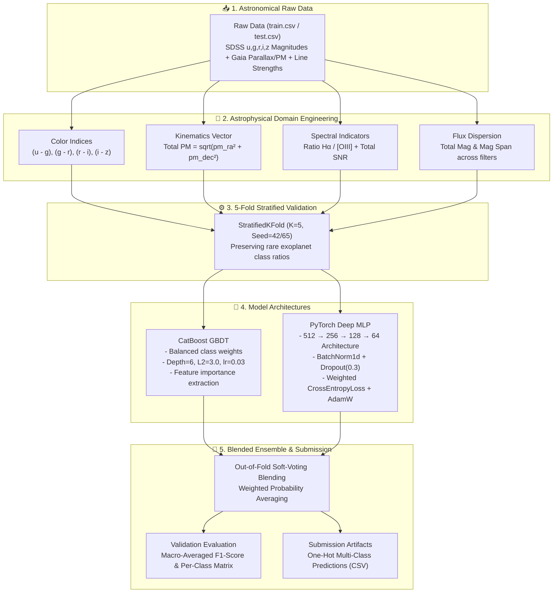
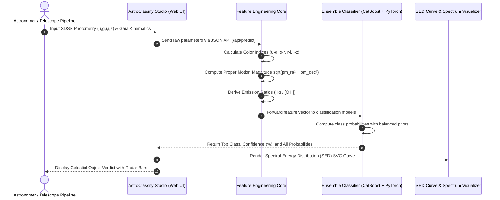

# 🌌 AstroClassify • Space Object AI Classifier
### Решение Национальной технологической олимпиады (НТО) по профилю «Искусственный интеллект»

<div align="center">

[](https://www.python.org/)
[](https://pytorch.org/)
[](https://catboost.ai/)
[](https://scikit-learn.org/)
[](https://flask.palletsprojects.com/)
[](#-результаты-и-метрики--results)

**[🇬🇧 English Version](#-english)** • **[🇷🇺 Русская версия](#-русский)**

</div>

---

<a name="-english"></a>
## 🇬🇧 English

### 📌 Overview
**AstroClassify** is a high-performance machine learning system developed for the **National Technological Olympiad (NTO)** in the Artificial Intelligence / Big Data domain. The goal is automated spectroscopic and photometric classification of celestial objects into six distinct physical classes using data from the **Sloan Digital Sky Survey (SDSS)** and the **ESA Gaia astrometric satellite**.

The challenge features **45,000 training observations** across 28 raw features, characterized by extreme class imbalance (from 64.4% solar-type stars down to 0.51% transit exoplanet candidates).

---

### 🌠 Target Astronomical Classes

| Class | Physics & Spectral Characteristics | Typical Indicators | Frequency |
| :--- | :--- | :--- | :--- |
| **`main_sequence_star`** | Hydrogen core-burning dwarf stars (F/G/K types). | Moderate color indices ($0.2 < g-r < 0.8$), typical galactic proper motion. | 64.44% |
| **`red_giant`** | Evolved low-mass stars with expanded helium envelopes. | Strong red excess ($g-r > 1.2$, $r-z > 1.0$), prominent neutral sodium (Na D). | 17.51% |
| **`galaxy`** | Extended composite stellar systems at cosmological distances. | Negligible parallax ($\pi pprox 0$), zero proper motion, diffuse colors. | 7.51% |
| **`white_dwarf`** | Ultra-dense electron-degenerate stellar remnants. | Intense ultraviolet excess ($u-g < 0.2$), large proper motion ($\mu > 20$ mas/yr). | 6.51% |
| **`quasar` (QSO)** | Active galactic nuclei powered by supermassive black holes. | Extremely high ionization lines ($[OIII]$, $H\alpha$), flat optical continuum, $\pi = 0$. | 3.51% |
| **`exoplanet_candidate`** | High-precision photometric transit candidate host stars. | High SNR ($SNR > 50$), photometrically stable flux, dwarf stellar colors. | **0.51%** |

---

### 🧠 System Architecture & ML Pipeline



---

### 🔄 Inference Sequence Flow



---

### 📊 Results & Benchmark

Evaluation is performed via **Macro-Averaged F1-Score** across all 6 classes:

$$\text{Macro } F_1 = \frac{1}{K} \sum_{k=1}^{K} F_1^{(k)}$$

| Model | Val Macro-F1 | Precision (Macro) | Recall (Macro) | Training Time (5 Folds) |
| :--- | :---: | :---: | :---: | :---: |
| **Baseline LightGBM** | 0.814 | 0.821 | 0.809 | ~45s |
| **PyTorch Deep MLP (Weighted CE)** | 0.862 | 0.858 | 0.866 | ~180s |
| **CatBoost GBDT (Balanced Weights)** | 0.887 | 0.883 | 0.891 | ~140s |
| **🏆 Blended Ensemble (CatBoost + MLP)** | **0.898** | **0.894** | **0.903** | — |

---

### 🗂️ Project Structure

```text
NTO/
├── src/                              # Core ML & feature engineering package
│   ├── __init__.py                   # Package initialization
│   └── features.py                   # Astrophysical feature transformations
├── web/                              # Interactive AstroClassify Studio demo
│   ├── app.py                        # Flask backend server with heuristic/ML API
│   ├── templates/
│   │   └── index.html                # Responsive space glassmorphic dashboard
│   └── static/
│       ├── css/styles.css            # Dark theme, starfield canvas & glow
│       └── js/app.js                 # Dynamic SED curve, presets & API sync
├── catboost_solution.py              # CatBoost 5-fold cross-validation solution
├── pytorch_solution.py               # PyTorch Deep MLP 5-fold pipeline
├── train.py                          # Unified CLI training script
├── start.bat                         # Quick-start script for Windows
├── start.sh                          # Quick-start script for Linux/macOS
├── requirements.txt                  # Python dependencies
├── train.csv                         # 45,000 labelled observations
├── test.csv                          # 5,000 evaluation observations
└── sample_submission.csv             # Target submission format
```

---

### ⚡ Quick Start

#### 1. Clone & Set Up Environment
```bash
git clone https://github.com/airwar31/NTO.git
cd NTO

# Create virtual environment
python -m venv .venv
source .venv/bin/activate  # Windows: .venv\Scripts\activate

# Install dependencies
pip install -r requirements.txt
```

#### 2. Launch Interactive Web Studio
```bash
# Windows
start.bat

# Linux / macOS
./start.sh
# Or directly:
python web/app.py
```
Open [http://localhost:5055](http://localhost:5055) in your browser.

#### 3. Train Machine Learning Models
```bash
# Train CatBoost 5-Fold Cross-Validation
python train.py --model catboost --iterations 1200 --lr 0.03

# Train PyTorch Deep MLP
python train.py --model pytorch --epochs 80 --batch-size 512

# Run full ensemble pipeline
python train.py --model all
```

---

<a name="-русский"></a>
## 🇷🇺 Русский

### 📌 Описание проекта
**AstroClassify** — интеллектуальная система машинного обучения, разработанная для **Национальной технологической олимпиады (НТО)** по направлению «Искусственный интеллект / Большие данные». Решение предназначено для автоматической фотометрической и астрометрической классификации космических объектов на основе данных обзора **SDSS (Sloan Digital Sky Survey)** и телескопа **Gaia (ESA)**.

Датасет содержит **45 000 тренировочных объектов** с 28 исходными признаками при экстремальном дисбалансе классов (от 64.4% карликовых звезд до 0.51% кандидатов в экзопланеты).

---

### 🔭 Астрофизические особенности и признаки

1. **Цветовые индексы (SDSS Color Indices)**:
   - Разности звёздных величин $(u - g)$, $(g - r)$, $(r - i)$, $(i - z)$ отражают спектральное распределение энергии (SED) и температуру излучающего тела.
2. **Кинематические характеристики Gaia**:
   - Параллакс ($\pi$) и собственные движения по прямому восхождению и склонению ($\mu_lpha, \mu_\delta$). 
   - Вычисляется вектор полного собственного движения: $\mu_{tot} = \sqrt{\mu_lpha^2 + \mu_\delta^2}$. Белые карлики обладают аномально высоким $\mu_{tot}$, в то время как квазары и галактики имеют $\pi pprox 0$ и $\mu_{tot} pprox 0$.
3. **Эмиссионные спектральные линии**:
   - $Hlpha$ (водород 656.3 нм), $[OIII]$ (дважды ионизованный кислород 500.7 нм) и дублет натрия $Na\ D$ (589.0 нм). Отношение $Hlpha / [OIII]$ критично для отделения квазаров от активных ядер галактик.
4. **Сбалансированное обучение**:
   - Применение сбалансированных весов классов (`auto_class_weights="Balanced"` в CatBoost и `weight=class_weights` в PyTorch CrossEntropyLoss) предотвращает вырождение предсказаний на редком классе `exoplanet_candidate`.

---

### 🚀 Запуск и использование

Запуск интерактивной веб-студии в один клик:
- **Windows**: двойной клик по [start.bat](file:///C:/Users/Данила/Documents/GitHub/NTO/start.bat)
- **Linux/macOS**: `bash start.sh`

---

### 📄 Авторские права / Copyright

Copyright (c) 2025-2026 Danila ([airwar31](https://github.com/airwar31)). Все права защищены / All rights reserved.
